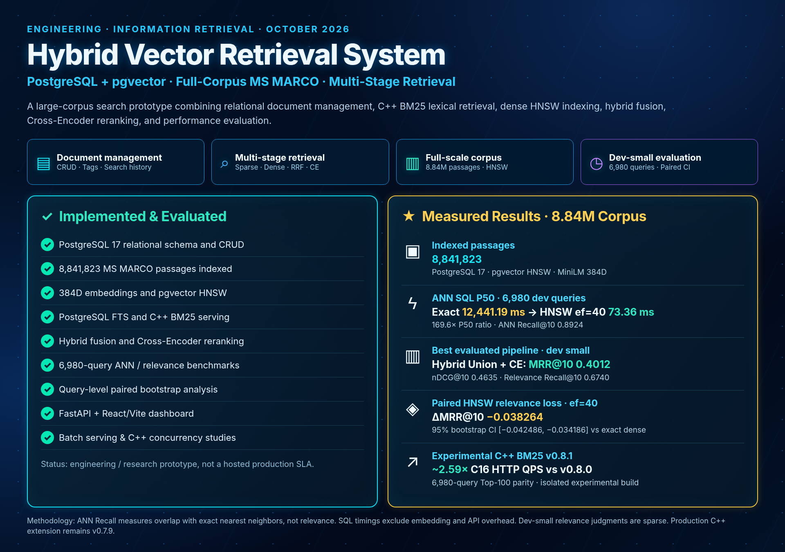
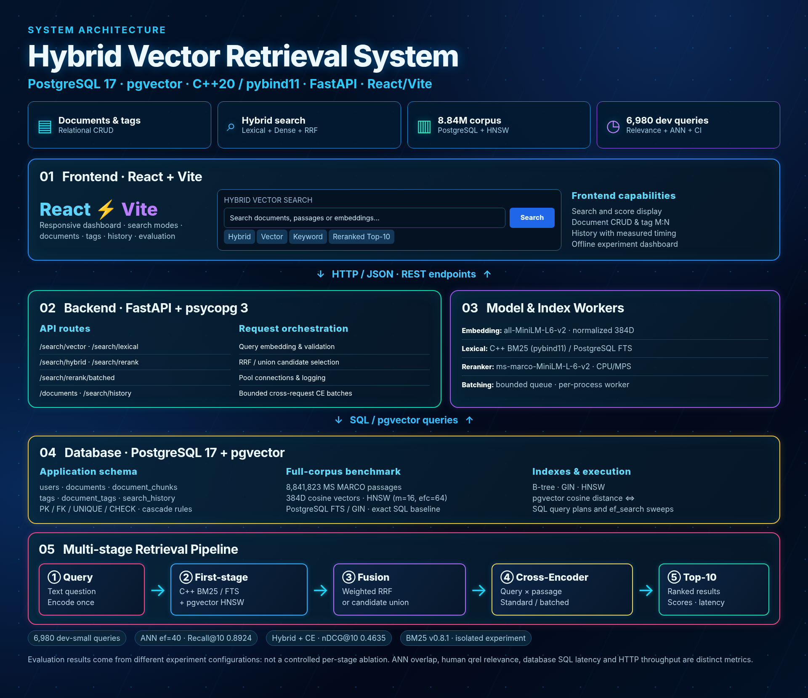
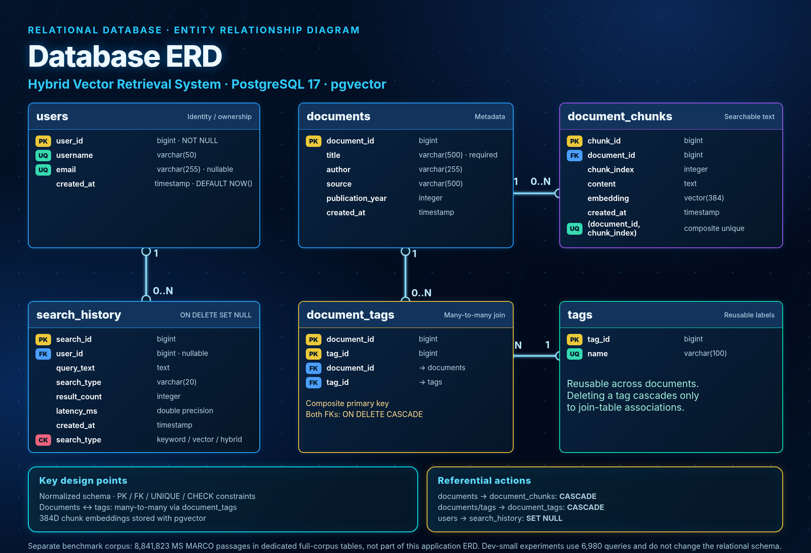

# Hybrid Vector Retrieval System

An information retrieval prototype built with **PostgreSQL 17, pgvector, C++ BM25, FastAPI, and React**. It manages documents, tags, and search history, and evaluates lexical search, dense retrieval, hybrid ranking, and Cross-Encoder reranking on **8,841,823 MS MARCO passages**.

| Experiment | Main result |
| --- | --- |
| Full-corpus dense retrieval | Across 6,980 dev-small queries, exact search had a SQL-path P50 of **12,441.19 ms**. HNSW at `ef_search=40` reached **73.36 ms** with **0.8924 ANN Recall@10**. |
| Full-corpus ranking quality | Hybrid Union + Cross-Encoder achieved **0.4012 MRR@10**, **0.4635 nDCG@10**, and **0.6740 relevance Recall@10** in the historical dev-small comparison. |
| C++ BM25 concurrency | At concurrency 16, HTTP throughput increased from **31.15 QPS** with v0.8.0 to **80.54 QPS** with the isolated v0.8.1 build. Both versions returned identical BM25 Top-100 rankings across all 6,980 queries. |
| Open-loop batching pilot | With frozen candidates and a 60-second measurement window, both the pair and token32 policies completed all **574 requests** successfully. Scheduled-to-completion P95 was **545.00 ms** and **675.80 ms**, respectively. |

[Quickstart](#quickstart) · [Architecture](#architecture) · [API](#api) · [Evaluation](#evaluation) · [Reproduction](#reproduction) · [Repository Layout](#repository)

<details>
<summary>System overview (October 2026 evaluation snapshot)</summary>



</details>

<a id="quickstart"></a>
## Quickstart

Use this setup to try document CRUD, tags, and lexical, dense, or hybrid search on application documents. It starts the API with a small BM25 corpus. To build the full MS MARCO corpus, embeddings, and indexes, see [Reproduction](#reproduction).

**Prerequisites** — Docker Compose, Python 3.13 (the version verified locally), CMake 3.20+, a C++20 compiler, and Node.js 22.12+. The first model load requires access to the model source or an existing local cache.

### 1. Start PostgreSQL and create the tables

Run these commands from the repository root. If `.env` already exists, check that `DATABASE_URL` matches the Compose credentials and host port.

```bash
test -f .env || cp .env.example .env
set -a
source .env
set +a

docker compose up -d postgres
docker compose exec -T postgres sh -c 'pg_isready -U "$POSTGRES_USER" -d "$POSTGRES_DB"'
```

Wait for `pg_isready` to report that it is accepting connections. On a **new database**, run the two schema files in order. The second creates an empty benchmark table so the dashboard can read its size.

```bash
docker compose exec -T postgres sh -c 'psql -X -v ON_ERROR_STOP=1 -U "$POSTGRES_USER" -d "$POSTGRES_DB"' < database/01_schema.sql
docker compose exec -T postgres sh -c 'psql -X -v ON_ERROR_STOP=1 -U "$POSTGRES_USER" -d "$POSTGRES_DB"' < database/13_msmarco_full.sql
```

`01_schema.sql` creates tables directly. Check the schema before applying it to an existing database. For an older application database, see [12_application_retrieval.sql](database/12_application_retrieval.sql) for the search column and indexes.

For an existing application database, apply [15_search_history_rerank.sql](database/15_search_history_rerank.sql) to enable rerank history.

```bash
docker compose exec -T postgres sh -c 'psql -X -v ON_ERROR_STOP=1 -U "$POSTGRES_USER" -d "$POSTGRES_DB"' < database/15_search_history_rerank.sql
```

### 2. Install the backend and prepare a startup corpus

```bash
python3 -m venv .venv
source .venv/bin/activate
python -m pip install -r requirements.txt pybind11

cmake -S cpp -B cpp/build \
  -DCMAKE_BUILD_TYPE=Release \
  -DBUILD_PYTHON_BINDINGS=ON \
  -DPython_EXECUTABLE="$(command -v python)" \
  -Dpybind11_DIR="$(python -m pybind11 --cmakedir)"
cmake --build cpp/build --parallel

mkdir -p cpp/data
python cpp/tools/convert_corpus.py cpp/tests/fixtures/demo.csv cpp/data/demo.bin

CPP_CORPUS_PATH="$PWD/cpp/data/demo.bin" \
  python -m uvicorn backend.api.main:app --host 127.0.0.1 --port 8000 --workers 1
```

CMake writes the `retrieval_cpp` Python extension to `backend/`. At startup, the API warms up the embedding model, opens a PostgreSQL connection pool, and loads the BM25 corpus. Application-only search also requires an importable extension and a valid `.bin` file. If you change Python versions, rebuild the extension with the interpreter that runs the API. [Application startup](backend/api/main.py) · [C++ corpus loader](backend/api/services/cpp_retrieval.py)

### 3. Create a document and verify search

Keep the API running and execute the following in another terminal. Creating a document also generates its embedding, so the new content is searchable by both text and vector.

```bash
curl -fsS http://127.0.0.1:8000/health

curl -fsS -X POST http://127.0.0.1:8000/documents \
  -H 'Content-Type: application/json' \
  -d '{"title":"PostgreSQL search","content":"PostgreSQL supports full-text search and vector search with pgvector."}'

curl -fsS -X POST http://127.0.0.1:8000/search/hybrid \
  -H 'Content-Type: application/json' \
  -d '{"query":"PostgreSQL search","corpus":"application","lexical_backend":"postgresql_fts","top_k":5}'
```

Open [Swagger UI](http://127.0.0.1:8000/docs) to explore the API. Start the frontend from the repository root.

```bash
cd frontend
npm ci
npm run dev -- --host 127.0.0.1 --port 5173 --strictPort
```

To verify create, update, delete, lexical, vector, hybrid search, and search history against a disposable database, run `python backend/tests/document_search_lifecycle.py` from the repository root while the API is running. See the [clean checkout verification](docs/demo-verification.md) for versions and test coverage.

Open the [local dashboard](http://127.0.0.1:5173). It selects application documents when the benchmark table is empty. For a populated benchmark table, `/stats` reports PostgreSQL's estimated row count after statistics are available. The evaluation tab displays archived results. [Frontend API configuration](frontend/src/api.js) · [Statistics route](backend/api/routers/system.py) · [Evaluation view](frontend/src/components/FullCorpusEvaluation.jsx)

<a id="architecture"></a>
## Architecture



| Layer | Implementation |
| --- | --- |
| Frontend | React 19 and Vite 8 provide document and tag management, search modes, query history, full-corpus evaluation, and C++ concurrency charts. |
| API | FastAPI, Uvicorn, and a psycopg 3 connection pool handle validation, candidate retrieval, scores, and timing. |
| Lexical retrieval | PostgreSQL English full-text search (FTS) uses GIN, `websearch_to_tsquery`, and `ts_rank_cd`. The benchmark corpus also supports C++20 BM25 through pybind11. |
| Dense retrieval | `sentence-transformers/all-MiniLM-L6-v2` produces 384-dimensional, L2-normalized vectors. pgvector searches by cosine distance (`<=>`) using an HNSW index built with `m=16` and `ef_construction=64`. |
| Fusion and reranking | The hybrid endpoint uses weighted Reciprocal Rank Fusion (RRF). The reranking endpoints deduplicate the union of lexical and dense candidates and score it with `cross-encoder/ms-marco-MiniLM-L-6-v2`. |
| Batched inference | Each API process has a bounded queue and one Cross-Encoder worker. The scheduler supports pair and token budgets and returns each request's results separately. |

Weighted RRF sums `weight / (rrf_k + rank)` across the lists in which a candidate appears. The API defaults to `rrf_k=60` and equal lexical and dense weights of 0.5. Historical experiments also used 0.1/0.9 weights and normalized-score fusion under their own configurations. The Cross-Encoder scores the original query and each candidate passage as a pair. [Weighted RRF](backend/api/services/weighted_rrf.py) · [Reranking routes](backend/api/routers/rerank.py)

### Database Design



| Table | Purpose and constraints |
| --- | --- |
| `users` | User records with unique usernames and nullable, unique email addresses. |
| `documents` | Document title, author, source, and publication year. |
| `document_chunks` | Document text, a nullable `vector(384)`, and a generated English `tsvector`. The pair `(document_id, chunk_index)` is unique. Deleting a document cascades to its chunks. |
| `tags`, `document_tags` | Tag names are unique. The join table uses `(document_id, tag_id)` as its composite primary key. Deleting a document or tag removes its associations. |
| `search_history` | Stores the query, search type, result count, and latency. The schema allows `keyword`, `vector`, `hybrid`, and `rerank` as search types. Deleting a user preserves the history and sets its user foreign key to null. |

The ERD summarizes the application tables. See the schema SQL for `document_chunks.search_vector` and the index definitions. Application search retrieves chunks and keeps the best matching chunk per document. The benchmark uses a separate `msmarco_full_documents` table with one row per passage and internal IDs of `pid + 1`. C++ retrieval uses the same IDs to fetch passage text from PostgreSQL. [Application schema](database/01_schema.sql) · [Application retrieval](backend/api/services/application_retrieval.py) · [Benchmark schema](database/13_msmarco_full.sql) · [Benchmark indexes](database/14_msmarco_full_indexes.sql) · [C++ candidate lookup](backend/api/services/cpp_candidates.py)

<a id="api"></a>
## API

| Method and route | Purpose |
| --- | --- |
| `GET /health`, `GET /stats` | Check database connectivity and view benchmark table and index statistics. |
| `POST /search/vector`, `POST /search/lexical` | Run HNSW vector search or PostgreSQL full-text search. |
| `POST /search/cpp`, `POST /search/cpp/lexical` | Return C++ BM25 IDs and scores, or results with passage text fetched from PostgreSQL. |
| `POST /search/hybrid` | Fuse lexical and dense candidate rankings with weighted RRF. |
| `POST /search/rerank`, `POST /search/rerank/batched` | Rerank the candidate union using per-request or cross-request batched inference. |
| `GET /search/history` | Read search history. |
| `GET /documents`, `POST /documents` | List or create documents. |
| `GET /documents/{document_id}`, `PUT /documents/{document_id}`, `DELETE /documents/{document_id}` | Read, update, or delete a document. |
| `GET /documents/{document_id}/tags`, `POST /documents/{document_id}/tags` | List or attach document tags. |
| `DELETE /documents/{document_id}/tags/{tag_id}` | Detach a tag from a document. |

- Search defaults to the `benchmark` corpus. For the small demo, send `"corpus":"application"` and use PostgreSQL FTS for the lexical branch. C++ BM25 in the hybrid and reranking endpoints is supported for the benchmark corpus.
- Use `postgresql_fts` with `/search/hybrid` and `postgres_fts` with both reranking endpoints. Hybrid search and reranking require `candidate_k >= top_k`. Hybrid weights must sum to 1. Responses report the HNSW search breadth in `effective_ef_search`. [Request models](backend/api/schemas/search.py)
- `/internal/benchmark/candidates` exports benchmark candidates from a loopback connection. The two frozen-candidate endpoints, `/internal/benchmark/rerank` and `/internal/benchmark/rerank/batched`, also require `ENABLE_FROZEN_BENCHMARK=1`. [Frozen-candidate API](backend/api/routers/benchmark_rerank.py)

With the full corpus and indexes loaded, send the same request to the standard and batched reranking endpoints.

```bash
for route in rerank rerank/batched; do
  curl -fsS -X POST "http://127.0.0.1:8000/search/$route" \
    -H 'Content-Type: application/json' \
    -d '{"query":"what is information retrieval","corpus":"benchmark","lexical_backend":"cpp_bm25","stopword_filter":true,"top_k":10,"candidate_k":50,"ef_search":160}'
  printf '\n'
done
```

### Batch Configuration

| Environment variable | Default | Purpose |
| --- | --- | --- |
| `CROSS_ENCODER_DEVICE` | `cpu` | Selects `cpu`, `mps`, or `auto`. The model falls back to CPU if Apple MPS is unavailable. |
| `CROSS_ENCODER_BATCH_SIZE` | `32` | Internal batch size used by the model's `predict()` call. |
| `RERANK_BATCH_POLICY` | `pair` | Select `token` to apply an additional token budget. |
| `RERANK_MAX_BATCH_REQUESTS` / `RERANK_MAX_BATCH_PAIRS` | `4` / `512` | Maximum requests and query–passage pairs per worker batch. |
| `RERANK_MAX_BATCH_TOKENS` | `65536` | Token-policy budget after truncation and before padding. |
| `RERANK_MAX_BATCH_WAIT_MS` / `RERANK_MAX_QUEUE_SIZE` | `5` / `128` | Batch formation window and pending queue capacity. |
| `RERANK_BATCH_TIMEOUT_SECONDS` | `10` | Wait limit per submission. A full queue returns HTTP 503, and a timeout returns HTTP 504. |
| `CPP_CORPUS_PATH` / `RETRIEVAL_CPP_EXTENSION` | `cpp/data/msmarco_full.bin` / unset | Overrides the corpus path or loads an isolated C++ extension. |

Batch responses report backlog wait, batch formation wait, and shared batch duration. `batch_id` groups responses from the same batch so the shared duration is counted once. The batch duration covers the entire worker step. Use a model profile for GPU forward-pass timing. [Batch worker](backend/api/services/dynamic_batch.py) · [Token budget](backend/api/services/token_budget.py) · [Model configuration](backend/api/services/cross_encoder.py)

<a id="evaluation"></a>
## Evaluation

Each comparison has its own corpus, workload, and timing boundary. **ANN Recall@10** measures the fraction of the exact dense Top-10 recovered by HNSW. **MRR@10, nDCG@10, Hit@10, and relevance Recall@10** use human relevance judgments (qrels). MS MARCO has sparse qrels, so these relevance scores describe performance on the available judgments. [MS MARCO Passage Ranking dataset](https://github.com/microsoft/msmarco/blob/master/Datasets.md) · [Dev-small manifest](artifacts/msmarco_full/dev_small_manifest.json)

The [November full-corpus experiment index](docs/evaluation/README.md) records the API HNSW sweep, the Cross-Encoder candidate budget pilot, and the live open-loop rerank comparison.

### Full-Corpus ANN, Latency, and Relevance

The benchmark retrieves the Top-10 for each of 6,980 dev-small queries over 8,841,823 passages. Timing starts when the SQL query is issued and ends when the client fetches the results. It includes the database round trip and excludes query encoding, HTTP, and reranking. The exact baseline disables index scans. The HNSW runs use the same index and vary `ef_search`.

| Dense retrieval method | SQL P50 (ms) | SQL P95 (ms) | ANN Recall@10 | Qrel MRR@10 | Qrel Hit@10 |
| --- | ---: | ---: | ---: | ---: | ---: |
| Exact | 12,441.19 | 14,343.13 | 1.0000 | 0.3056 | 0.5781 |
| HNSW `ef=10` | 30.49 | 62.22 | 0.7596 | 0.2252 | 0.4307 |
| HNSW `ef=20` | 41.87 | 83.50 | 0.8406 | 0.2508 | 0.4778 |
| HNSW `ef=40` | 73.36 | 140.10 | 0.8924 | 0.2673 | 0.5089 |
| HNSW `ef=80` | 105.58 | 193.52 | 0.9287 | 0.2809 | 0.5311 |
| HNSW `ef=160` | 180.54 | 332.48 | 0.9517 | 0.2890 | 0.5464 |

The exact-to-HNSW SQL P50 ratio was **169.6×** at `ef=40`. With 10,000 paired bootstrap resamples at the query level (seed 42), HNSW minus exact yielded **−0.038264 ΔMRR@10** at `ef=40`, with a 95% CI of **[−0.042486, −0.034186]**. At `ef=160`, the difference was **−0.016602**, with a 95% CI of **[−0.019482, −0.013816]**. The evaluation view records all five intervals. The timing data comes from one full sweep and depends on cache state, query order, and environment. [ANN benchmark](backend/scripts/benchmark_msmarco_dev_ann.py) · [Relevance analysis](backend/scripts/analyze_ann_relevance.py) · [Results and confidence intervals](frontend/src/components/FullCorpusEvaluation.jsx)

### Full-Corpus Multistage Ranking

These historical runs used the same 6,980 queries. Candidate depths, component versions, and retrieval settings varied across pipelines, so each row describes its run. Isolating the effect of a stage requires a matched comparison.

| Retrieval pipeline | MRR@10 | nDCG@10 | Relevance Recall@10 |
| --- | ---: | ---: | ---: |
| C++ BM25 | 0.178503 | 0.222467 | 0.371466 |
| Dense HNSW | 0.288959 | 0.345345 | 0.536151 |
| Weighted Hybrid RRF | 0.290823 | 0.349124 | 0.545463 |
| Dense + Cross-Encoder | 0.372126 | 0.428756 | 0.620690 |
| **Hybrid Union + Cross-Encoder** | **0.401195** | **0.463473** | **0.674009** |

In the historical full-corpus comparison, union reranking improved nDCG@10 over dense reranking by **+0.034717**, with a 95% paired CI of **[+0.030622, +0.038986]**. This interval captures the difference between the two complete pipelines. A separate frozen protocol with **500,000 passages and 500 held-out queries** used PostgreSQL FTS Top-50 and dense Top-50. It measured **0.66329** nDCG@10 for Dense + Cross-Encoder and **0.67883** for Union + Cross-Encoder, a paired difference of **+0.01554** with a 95% CI of **[+0.00697, +0.02533]**. The two studies used different corpus coverage and query selection. [Historical full-corpus results](frontend/src/components/FullCorpusEvaluation.jsx) · [Full-corpus paired analysis script](backend/scripts/evaluate_paired_bootstrap_dev.py) · [500-query protocol](artifacts/relevance/protocol_frozen.json) · [Reproduce the 500-query results](docs/evaluation/heldout-reranking.md)

### Cross-Encoder Candidate Budgets

A separate local research checkout includes an exploratory candidate study. A hash of each query ID assigned 3,567 queries to validation and 3,413 to test. The study compares dense candidates, RRF, and dense/BM25-only quotas under a budget of 40 Cross-Encoder candidates. BM25-only candidates exclude passages in the dense Top-50. Dense candidates fill any remaining slots. The evaluation combines cached scores with newly computed scores for missing pairs.

| Candidate strategy | Cross-Encoder budget | Validation nDCG@10 | Test nDCG@10 |
| --- | ---: | ---: | ---: |
| Dense40 | 40 | 0.415994 | 0.436644 |
| RRF40 | 40 | 0.435553 | 0.459400 |
| Dense30 + BM25-only 10 | 40 | 0.441218 | 0.462431 |
| RRF50 (higher-budget reference) | 50 | 0.445107 | 0.465191 |

The 30+10 quota had the highest validation nDCG@10 among the 40-candidate quotas. The budgets count candidates. Measuring serving cost requires actual token counts and latency. This is an offline study on the public dev-small split. The full local results are in `results/msmarco_full/relevance/dev_v067/ce_candidate_ablation/quota_experiment/quota_ablation_results.json`.

### C++ BM25 Concurrency

The C++ core uses an inverted index for BM25 and exposes it to Python through pybind11. Historical records identify v0.7.9 as the default serving extension. v0.8.0 and v0.8.1 were isolated experimental builds. The v0.8.1 configuration releases the Python GIL during search and provides four reusable workspaces.

At concurrency 16, with 500 requests per concurrency level against `/search/hybrid`, HTTP P95 dropped from **630.33 ms** in v0.8.0 to **261.36 ms** in v0.8.1, with **2.59×** the throughput. A separate v0.8.1 memory-check run reached **80.06 QPS**. The per-query comparison found identical BM25 Top-100 rankings across all 6,980 dev-small queries. [Performance CSV](artifacts/evaluations/v081/performance/performance_comparison.csv) · [Benchmark configuration and counts](artifacts/evaluations/v081/performance/benchmark_validation.json) · [Ranking parity script](backend/scripts/verify_bm25_version_parity_v081.py)

### Cross-Encoder Serving and Load Tests

| Workload | Observation |
| --- | --- |
| Historical closed-loop HTTP, Apple MPS, concurrency 16 | The test measured 1,000 requests across two pipelines and five concurrency levels. At concurrency 16, standard and batched reranking reached **8.360** and **10.895 QPS**, with P95 of **2,078.05** and **1,836.62 ms**, respectively. Throughput stayed flat or fell at concurrency 1–2. |
| Frozen-candidate open-loop pilot, 10 RPS target, 60 seconds | The pair and token32 policies each scheduled and completed **574** requests. Each completed **571** within the measurement window, for **9.52 RPS** of window goodput. Scheduled-to-completion P95 was **545.00 ms** for pair and **675.80 ms** for token32. |
| Model profiling on Apple MPS | A historical profile used real candidates from 10 queries. At 128 pairs, the real inputs took about **130.30 ms** and short synthetic inputs took about **45.00 ms**. Sorting inputs by length before calling the model yielded inconsistent gains under that setup. |

In a closed-loop test, clients send the next request after a response. The open-loop test schedules Poisson arrivals with a fixed seed. The frozen-candidate endpoints bypass live retrieval, so the pilot reflects the model, batch configuration, and offered load of that run. To assess capacity, read the generated arrival rate, in-window completions, HTTP and scheduled latency, dispatch lag, backlog, and drain together. A historical live-route parity check matched the Top-10 order for all 10 queries. Frozen-candidate tests and current regression tests use separate protocols. [Historical closed-loop benchmark](backend/scripts/benchmark_dynamic_batch_v075.py) · [Frozen-candidate closed-loop benchmark](backend/scripts/benchmark_frozen_http.py) · [Open-loop benchmark](backend/scripts/benchmark_open_loop_duration.py) · [Real-input model profile](backend/scripts/profile_real_cross_encoder_v077.py)

Local evidence includes `results/msmarco_full/latency/api_v076/config_B_formal_1000/summary.json` and `reports/performance/cross_encoder/open_loop_batch_id/{pair,token32}_10rps_pilot.json`. Earlier pair/token sweeps, capacity tests, and MPS profiles are in `reports/performance/cross_encoder/`.

<a id="reproduction"></a>
## Reproduction

### 1. Build the Full MS MARCO Corpus

Complete the database and dependency setup in [Quickstart](#quickstart). Load `.env` and run the following from the repository root. This downloads the passages, writes 384-dimensional embeddings, and builds the indexes. The original setup recorded about **39 GB** of database usage, including about **17 GB** for HNSW and **904 MB** for GIN. Allow additional space for the CSV export, C++ binary corpus, model cache, and index builds. The API loads the C++ BM25 corpus into memory at startup.

```bash
python backend/scripts/ingest_msmarco_full.py
python backend/scripts/embed_msmarco_full.py

docker compose exec -T postgres sh -c 'psql -X -v ON_ERROR_STOP=1 -U "$POSTGRES_USER" -d "$POSTGRES_DB"' < database/14_msmarco_full_indexes.sql

docker compose exec -T postgres sh -c 'psql -X -v ON_ERROR_STOP=1 -U "$POSTGRES_USER" -d "$POSTGRES_DB" -c "SELECT count(*) AS passages, count(embedding) AS embedded FROM msmarco_full_documents;"'
```

After a full build, both counts should be **8,841,823**. Export IDs and text from the same table to build the C++ corpus. To test ingestion or embedding with `--max-docs`, use a separate database and keep the full-corpus output paths for the full build.

```bash
mkdir -p cpp/data
docker compose exec -T postgres sh -c 'psql -q -X -v ON_ERROR_STOP=1 -U "$POSTGRES_USER" -d "$POSTGRES_DB" -c "COPY (SELECT document_id, content FROM msmarco_full_documents ORDER BY document_id) TO STDOUT WITH (FORMAT csv, HEADER true)"' > cpp/data/msmarco_full.csv
python cpp/tools/convert_corpus.py cpp/data/msmarco_full.csv cpp/data/msmarco_full.bin

CPP_CORPUS_PATH="$PWD/cpp/data/msmarco_full.bin" \
  python -m uvicorn backend.api.main:app --host 127.0.0.1 --port 8000 --workers 1
```

Ingestion resumes from the maximum stored passage ID. Embedding resumes from the maximum ID with an embedding. If you have partially edited the data, check for missing IDs and unembedded rows. [Ingestion](backend/scripts/ingest_msmarco_full.py) · [Embedding](backend/scripts/embed_msmarco_full.py) · [Indexes](database/14_msmarco_full_indexes.sql) · [C++ corpus conversion](cpp/tools/convert_corpus.py)

### 2. Run Vector and Relevance Evaluations

The repository includes the [6,980-query dev-small manifest](artifacts/msmarco_full/dev_small_manifest.json). To rebuild it from the official files, put `queries.dev.small.tsv` and `qrels.dev.small.tsv` in `data/msmarco/dev/` and run [prepare_msmarco_dev.py](backend/scripts/prepare_msmarco_dev.py). Start with 10 queries to verify the configuration and query plans. In the original setup, the exact SQL path averaged about 12.8 seconds per query, or about 25 hours for the 6,980 exact searches alone.

The benchmark checks `results/msmarco_full/ann_dev_6980/experiment_config.json`. On a fresh setup, the following command creates the configuration if the file is missing.

```bash
mkdir -p results/msmarco_full/ann_dev_6980
if [ ! -e results/msmarco_full/ann_dev_6980/experiment_config.json ]; then
  cat > results/msmarco_full/ann_dev_6980/experiment_config.json <<'JSON'
{
  "dataset": "msmarco_passage_dev_small",
  "manifest": "artifacts/msmarco_full/dev_small_manifest.json",
  "corpus": "msmarco_full_documents",
  "expected_documents": 8841823,
  "embedding_model": "sentence-transformers/all-MiniLM-L6-v2",
  "embedding_normalized": true,
  "embedding_dimensions": 384,
  "distance": "cosine",
  "top_k": 10,
  "hnsw_index": "idx_msmarco_full_embedding_hnsw",
  "hnsw_m": 16,
  "hnsw_ef_construction": 64,
  "ef_search": [
    10,
    20,
    40,
    80,
    160
  ],
  "query_order": "manifest_order",
  "document_id_mapping": "msmarco_pid_plus_1"
}
JSON
fi

python backend/scripts/benchmark_msmarco_dev_ann.py --limit 10

# Run after verifying the full database, index, and configuration.
python backend/scripts/benchmark_msmarco_dev_ann.py --limit 6980
python backend/scripts/analyze_ann_relevance.py
```

Results and checkpoints are stored in `results/msmarco_full/ann_dev_6980/`. Reuse the checkpoints from the 10-query trial with the same database and index. Before changing the data or model, move the old outputs to another directory to avoid reusing stale checkpoints. The full relevance analysis requires the same 6,980 query IDs in the manifest, the exact results, and every HNSW configuration. See the [full-corpus artifacts](artifacts/msmarco_full/) for earlier 500- and 10,000-query summaries.

### 3. Benchmark Batching With Frozen Candidates

Set `ENABLE_FROZEN_BENCHMARK=1` before starting the API. To compare the pair and token policies, use one Uvicorn worker and keep the query sample, seed, and server settings fixed apart from the policy and token budget. Use the original `msmarco_frozen_k50.json` to compare with the pilot. This dataset is local to the working tree.

```bash
python backend/scripts/benchmark_open_loop_duration.py \
  --base-url http://127.0.0.1:8000 \
  --dataset reports/performance/cross_encoder/datasets/msmarco_frozen_k50.json \
  --pipeline batched --arrival-rate 10 \
  --warmup-seconds 10 --measurement-seconds 60 --workers 128 \
  --seed 42 --timeout 60 --output results/open_loop_pair_10rps.json
```

The pilot used MPS, a model batch size of 32, a limit of 4 requests and 800 pairs per worker batch, a 5 ms formation window, and a 60-second timeout. The token32 policy used a budget of 32,768 tokens. Use a separate output filename for the other policy. Use `--pipeline baseline` to measure per-request reranking on the same frozen candidates. Capacity results include requests waiting for a load-generator worker at the end of the window. `server_profile` summarizes request-level observations. `server_batch_profile` counts each observed batch ID once. Record the commit, working-tree state, dataset hash, hardware, package versions, model and index settings, warmup, arrival rate, in-window goodput, and error rate. [Open-loop output and capacity metrics](backend/scripts/benchmark_open_loop_duration.py) · [Frozen-candidate request format](backend/api/routers/benchmark_rerank.py)

### 4. Run Tests

```bash
# Run from the repository root with .venv active and DATABASE_URL loaded.
python -m pip install httpx
python -m pytest -q
ctest --test-dir cpp/build --output-on-failure
(cd frontend && npm run build && npm run lint)
```

The pytest suite covers API request and response contracts, RRF, candidate handling, reranking parity, and batching. Some tests may require a model cache, a reachable PostgreSQL instance, or a running API. With the Quickstart API running against a test database, run `python backend/tests/document_search_lifecycle.py` to verify create, update, delete, and lexical, dense, and hybrid search. Set `DOCUMENT_SEARCH_BASE_URL` if the test API runs on a different port. Older adaptive-gate and text preprocessing experiments may also require `pandas`, `scikit-learn`, or `ftfy`. See each script for its dependencies.

<a id="repository"></a>
## Repository Layout

| Path | Contents |
| --- | --- |
| [`backend/api/`](backend/api/) | API, database connections, request models, retrieval, model inference, and dynamic batching. |
| [`backend/scripts/`](backend/scripts/) | Full-corpus ingestion and embedding, ANN and relevance evaluation, profiling, candidate studies, and HTTP load tests. |
| [`backend/tests/`](backend/tests/) | API contract, ranking, model, and batching regression tests. |
| [`cpp/`](cpp/) | C++20 BM25 core, pybind11 bindings, tests, benchmarks, and corpus conversion. |
| [`database/`](database/) | Application and full-corpus schemas, earlier scale tests, and FTS, HNSW, and IVFFlat SQL. |
| [`frontend/`](frontend/) | React and Vite dashboard with visualizations of archived evaluations. |
| [`artifacts/`](artifacts/) | Versioned experiment manifests, summaries, charts, and C++ experiment sources. |
| [`benchmarks/`](benchmarks/) | HTTP benchmarks for hybrid retrieval and reranking. |
| [`docs/`](docs/) | Overview, architecture, and ERD figures in PNG and JPG formats. |
| `data/`, `cpp/data/`, `results/`, `reports/` | Local datasets, binary corpora, raw results, and research reports. Check which files your checkout includes before reproducing a run. |

The fixed-duration open-loop tool is included in this checkout. Candidate quota scripts, some batching diagnostics, frozen candidates, and raw reports are local research assets. Use the versions, models, and assets recorded for the experiment you want to reproduce.

## Research and Deployment Scope

The project provides a full-stack demo and large-corpus research evaluations. Its data and models primarily target English queries. Full-scale runs require rebuilding or obtaining the large local assets. Production deployment would require additional validation of sustained capacity, repeatability across hardware, authentication, and service availability. The reported results apply to the stated experiment conditions.

## Author and License

Ravan Chuang · [MIT License](LICENSE). MS MARCO, model weights, and dependencies are subject to their respective terms.
