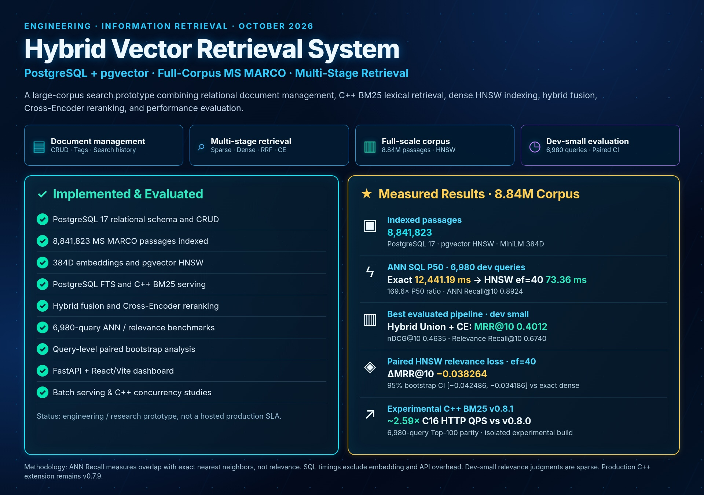
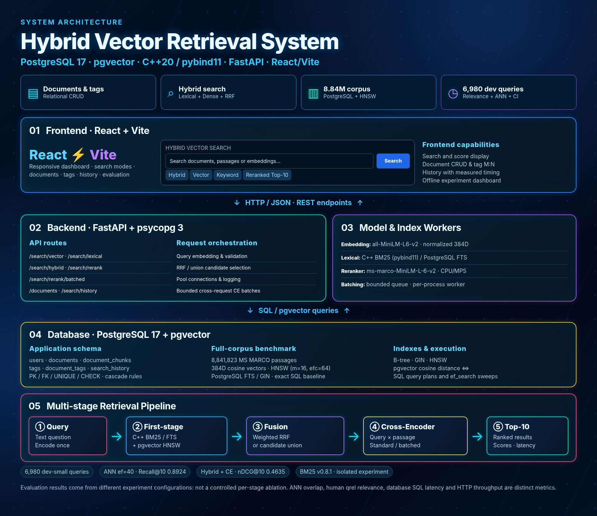
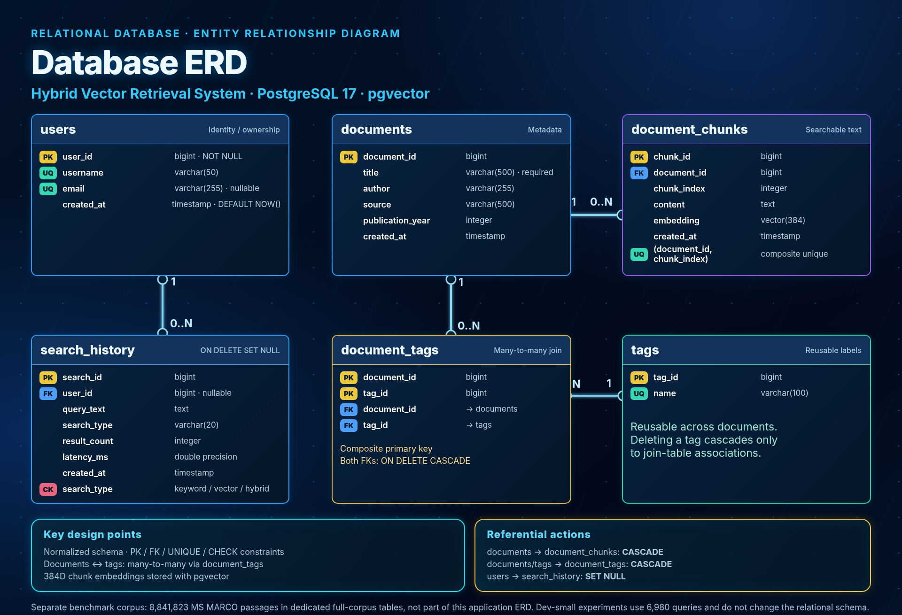

# Hybrid Vector Retrieval System

**Full-corpus information retrieval · PostgreSQL / pgvector · C++ BM25 · Cross-Encoder serving**

A multi-stage search system combining relational data management, lexical and dense retrieval, approximate nearest-neighbor (ANN) indexing, hybrid candidate generation, Cross-Encoder reranking, and bounded **cross-request dynamic batching**. The project emphasizes measurable retrieval quality, database systems engineering, and reproducible performance analysis.

> **Project status — October 24, 2026 (v0.8.1 experimental BM25 branch):** The database, full MS MARCO corpus, retrieval pipelines, relevance evaluation, FastAPI backend, relational CRUD, and React/Vite dashboard are implemented. C++ BM25 serving, batched Cross-Encoder inference, concurrency/parity tests, real-document profiling, and a 6,980-query dev-set ANN study have also been evaluated. The v0.8.1 BM25 implementation is an isolated experimental build; the deployed extension remains v0.7.9. This is an **engineering/research prototype**, not a production-ready hosted search service.



## At a glance

| Dimension | Measured result / implementation |
| --- | --- |
| Indexed corpus | **8,841,823 MS MARCO passages** |
| Dense representation | Normalized **384-dimensional** `all-MiniLM-L6-v2` embeddings |
| Vector index | PostgreSQL 17 + pgvector **HNSW** (`m=16`, `ef_construction=64`) |
| Lexical retrieval | PostgreSQL FTS/GIN and **C++ BM25** serving backend |
| Dev-small query set | All **6,980 MS MARCO passage dev-small queries** with positive qrels |
| Best measured dev pipeline | **Hybrid union + Cross-Encoder** · MRR@10 **0.4012** · nDCG@10 **0.4635** · relevance Recall@10 **0.6740** |
| 6,980-query ANN, `ef_search=40` | **73.36 ms SQL P50 · ANN Recall@10 0.8924 · MRR@10 0.2673** (exact SQL P50: 12,441.19 ms) |
| ANN relevance, `ef_search=40` versus exact | **ΔMRR@10 −0.038264**, paired bootstrap 95% CI **[−0.042486, −0.034186]** |
| Experimental C++ BM25 v0.8.1 | **~2.59× C16 HTTP QPS** vs isolated v0.8.0; 6,980-query Top-100 rankings identical |
| Dynamic batching, C16 | **10.895 vs 8.360 QPS** (batched vs baseline, one historical 1,000-request test) |
| Batch ranking parity | **10/10** tested queries: identical Top-1, Top-10 membership and order |

**Interpretation:** ANN Recall is **exact-neighbor overlap**, not judged relevance. SQL timings exclude embedding, reranking and HTTP overhead; concurrency QPS is measured separately. The retrieval-pipeline methods were evaluated under partly different historical configurations and **are not a fully matched ablation**. MS MARCO dev-small labels are sparse. No result presented here is claimed as an official leaderboard submission.

## Contents

- [Architecture](#architecture)
- [Features and technology](#features-and-technology)
- [Database design](#database-design)
- [Retrieval pipelines](#retrieval-pipelines)
- [Evaluation protocol](#evaluation-protocol)
- [Retrieval quality](#retrieval-quality)
- [ANN and scalability](#ann-and-scalability)
- [MS MARCO dev-small ANN and relevance study](#ms-marco-dev-small-ann-and-relevance-study)
- [Experimental C++ BM25 v0.8.1](#experimental-c-bm25-v081)
- [Dynamic batching and serving](#dynamic-batching-and-serving)
- [Cross-Encoder profiling](#cross-encoder-profiling)
- [Getting started](#getting-started)
- [API examples](#api-examples)
- [Repository guide](#repository-guide)
- [Testing and reproducibility](#testing-and-reproducibility)
- [Limitations and roadmap](#limitations-and-roadmap)

## Architecture



```text
                         React / Vite dashboard
                                  │ REST / JSON
                                  ▼
                              FastAPI
                                  │
                  ┌───────────────┴────────────────┐
                  │                                │
          Relational application             Search pipeline
          documents / tags / history               │
                  │                         Query embedding
                  │                                │
                  │              ┌─────────────────┴──────────────────┐
                  │              ▼                                    ▼
                  │       Lexical retrieval                      Dense retrieval
                  │       PostgreSQL FTS / GIN                  pgvector HNSW
                  │       or C++ BM25                           cosine distance
                  │              │                                    │
                  │              └─────────────────┬──────────────────┘
                  │                                ▼
                  │                       Candidate union / fusion
                  │                                │
                  │                   ┌────────────┴─────────────┐
                  │                   ▼                          ▼
                  │              Standard CE              Batched CE worker
                  │                   │                    bounded queue +
                  │                   │                    cross-request batching
                  │                   └────────────┬─────────────┘
                  │                                ▼
                  │                          Ranked Top-K
                  ▼
          PostgreSQL 17 + pgvector
```

The normalized application schema and the large benchmark/serving corpus are logically separated. Application CRUD, referential integrity, and search history remain database-backed. The full MS MARCO corpus and its HNSW/GIN indexes support large-scale retrieval experiments. The Cross-Encoder is `cross-encoder/ms-marco-MiniLM-L-6-v2`.

## Features and technology

| Layer | Components |
| --- | --- |
| Database | PostgreSQL 17, pgvector, B-tree, GIN, HNSW, experimental IVFFlat |
| Backend | Python, FastAPI, Uvicorn, psycopg 3, `psycopg_pool` |
| Dense retrieval | `sentence-transformers/all-MiniLM-L6-v2` (384D, normalized) |
| Lexical retrieval | PostgreSQL `tsvector` / `websearch_to_tsquery`; C++ BM25 |
| Reranking | `cross-encoder/ms-marco-MiniLM-L-6-v2`, PyTorch CPU/MPS |
| Serving | Per-process bounded dynamic batch worker, queue/timeout controls, single-request baseline |
| Frontend | React 19, Vite 8, CSS |
| Infrastructure | Docker Compose, local Python virtual environment |
| Evaluation | MS MARCO relevance judgments, ANN exact-neighbor comparisons, HTTP concurrency tests, paired bootstrap |

### Supported capabilities

- Exact cosine vector retrieval and approximate HNSW retrieval.
- PostgreSQL full-text search and C++ BM25 lexical retrieval.
- Hybrid RRF and normalized-score fusion baselines; lexical/dense candidate union.
- Cross-Encoder reranking with both standard and batched API paths.
- Search-history persistence and document/tag CRUD with foreign-key constraints.
- Dashboard for retrieval, statistics, and relational database operations.
- Index-build, ingestion, relevance, latency, throughput, and ranking-parity experiments.

## Database design



| Table | Role |
| --- | --- |
| `users` | Application users |
| `documents` | Document metadata |
| `document_chunks` | Searchable chunks, embeddings, generated full-text representation |
| `tags` | Unique tag definitions |
| `document_tags` | Document–tag many-to-many association |
| `search_history` | Query type, result count, timing, and history |

The normalized application schema enforces primary/foreign keys, uniqueness, checks, and cascade rules. Deleting a document cascades to its chunks and tag associations without deleting reusable tag records. Application chunks have full-text and vector indexes. Large-scale benchmark tables are maintained separately from the application workload.

**Representative vector query** (illustrative schema; adapt to the actual table and connection parameters):

```sql
SELECT document_id, content, embedding <=> %s::vector AS distance
FROM msmarco_full_documents
ORDER BY embedding <=> %s::vector
LIMIT 10;
```

**Representative HNSW index:**

```sql
CREATE INDEX idx_msmarco_full_embedding_hnsw
ON msmarco_full_documents
USING hnsw (embedding vector_cosine_ops)
WITH (m = 16, ef_construction = 64);
```

`ef_search` is varied at query time to study ANN recall–latency trade-offs. A GIN index accelerates PostgreSQL full-text queries. Full-corpus HNSW and GIN indexes are substantial local assets; they are **not included in this Git repository**.

## Retrieval pipelines

### First-stage retrieval

1. **Lexical:** PostgreSQL FTS/GIN or the local C++ BM25 backend.
2. **Dense:** Encode the query with normalized MiniLM embeddings; retrieve cosine nearest neighbors through pgvector HNSW.
3. **Fusion:** Compare reciprocal rank fusion (RRF), weighted RRF, and normalized-score fusion; alternatively take the lexical/dense union for reranking.

For two ranked lists, RRF is:

$$
\mathrm{RRF}(d)=\sum_{r\in\mathcal R}\frac{1}{k+\operatorname{rank}_r(d)}
$$

The evaluated weighted-RRF baseline uses `k=60`, lexical weight `0.1`, and dense weight `0.9`.

### Multi-stage reranking

```text
Query → lexical Top-50 + dense Top-50 → deduplicated union
      → Cross-Encoder(query, passage) → final Top-10
```

The **6,980-query dev-small retrieval-quality table** below includes the C++ BM25 lexical baseline. Its pipelines were measured across different historical configurations; query-set alignment alone does not make the methods a controlled ablation. Do not attribute a gain exclusively to fusion or reranking without matching candidate depth, component version and search settings.

## Evaluation protocol

- **Corpus:** 8,841,823 MS MARCO passages in PostgreSQL/pgvector, queried using normalized 384D MiniLM embeddings.
- **Queries and judgments:** **6,980 MS MARCO passage dev-small** queries with positive qrels. The local document-ID mapping is official `pid + 1`.
- **ANN Recall@10:** percentage overlap of approximate vector Top-10 with exact cosine vector Top-10; not human relevance.
- **Qrel MRR@10 / Hit@10:** judged passage positions and judged hit rate for dense exact versus HNSW; sparse qrels are not exhaustive.
- **Qrel MRR@10 / nDCG@10 / relevance Recall@10:** separate pipeline comparison on 6,980 dev-small queries; not a strict single-version ablation.
- **SQL latency:** database query execution only, excluding embedding, network, API and Cross-Encoder; HNSW `ef_search` varied while the corpus/index remained fixed.
- **Uncertainty:** 10,000 paired query bootstrap resamples, seed 42, percentile 95% intervals for ANN-versus-exact MRR loss. A separate paired nDCG interval is reported for hybrid-CE versus dense-CE under its own experiment configuration.
- **Serving metrics:** closed-loop HTTP concurrency QPS/P95 are kept separate from database-only sequential SQL latency.

## Retrieval quality

### MS MARCO passage dev-small — 6,980 queries

| Retrieval pipeline | MRR@10 | nDCG@10 | Relevance Recall@10 |
| --- | ---: | ---: | ---: |
| C++ BM25 (sparse) | 0.178503 | 0.222467 | 0.371466 |
| Dense HNSW | 0.288959 | 0.345345 | 0.536151 |
| Weighted hybrid RRF | 0.290823 | 0.349124 | 0.545463 |
| Dense + Cross-Encoder | 0.372126 | 0.428756 | 0.620690 |
| **Hybrid candidate union + Cross-Encoder** | **0.401195** | **0.463473** | **0.674009** |

**Paired reranking comparison:** Union+CE minus Dense+CE yielded **ΔnDCG@10 +0.034717**, with a 95% paired-bootstrap interval **[+0.030622, +0.038986]** (10,000 resamples) in the recorded comparison. This interval is not from the exact-vs-HNSW ANN experiment and must not be mixed with those intervals.

**Caveat:** These reported pipeline results span historical retrieval configurations, component versions, and candidate settings. They demonstrate observed quality levels but do not isolate the causal effect of each individual stage.

## ANN and scalability

The full corpus is stored separately from the normalized application tables. The HNSW vector index uses cosine distance with `m=16` and `ef_construction=64`; PostgreSQL FTS uses GIN. In local storage observations, the database occupied roughly **39 GB**, the HNSW index roughly **17 GB**, and the full-corpus GIN index roughly **904 MB**. Docker shared memory was increased to 8 GB during index construction; the exact full-corpus HNSW build duration was not recorded.

The main ANN comparison is the **complete 6,980-query dev-small benchmark** in the following section. It includes SQL P50/P95, exact-neighbor overlap and qrel relevance, and should replace earlier small-query timing snapshots when presenting the current benchmark. The raw corpus, model caches, index assets and query checkpoints are **not distributed through Git**.

## MS MARCO dev-small ANN and relevance study

**Protocol (October 2026).** The full **8,841,823-passage** corpus was searched using **all 6,980 queries** in the MS MARCO passage **dev-small** set, with positive qrels from `artifacts/msmarco_full/dev_small_manifest.json`. The local document-ID mapping is **official MS MARCO passage ID + 1**. Query embeddings use normalized `sentence-transformers/all-MiniLM-L6-v2` (384 dimensions); pgvector cosine distance (`<=>`) and HNSW `m=16`, `ef_construction=64` were used. Each query retrieves **Top-10**. The database was PostgreSQL 17 / pgvector 0.8.6 in the measured environment.

**Latency scope:** SQL retrieval latency only; excludes query encoding, HTTP, and reranking. Exact nearest-neighbor search was forced without index scans; HNSW runs used `ef_search` values 10, 20, 40, 80, 160. Cache state, query order, client configuration and execution environment can affect timings; the P50 ratios are descriptive, not controlled end-to-end speedup estimates.

| Method | SQL P50 (ms) | SQL P95 (ms) | ANN Recall@10 vs exact | Qrel MRR@10 | Qrel Hit@10 |
| --- | ---: | ---: | ---: | ---: | ---: |
| Exact dense | 12,441.19 | 14,343.13 | 1.0000 | 0.3056 | 0.5781 |
| HNSW `ef=10` | 30.49 | 62.22 | 0.7596 | 0.2252 | 0.4307 |
| HNSW `ef=20` | 41.87 | 83.50 | 0.8406 | 0.2508 | 0.4778 |
| HNSW `ef=40` | 73.36 | 140.10 | 0.8924 | 0.2673 | 0.5089 |
| HNSW `ef=80` | 105.58 | 193.52 | 0.9287 | 0.2809 | 0.5311 |
| HNSW `ef=160` | 180.54 | 332.48 | 0.9517 | 0.2890 | 0.5464 |

The approximate **169.6× P50 ratio** for `ef=40` compares measured exact-scan P50 with HNSW P50; it is **not** an end-to-end service speedup. Increasing `ef_search` improves exact-neighbor overlap and qrel MRR in this evaluation, but even `ef=160` does not reproduce exact dense relevance.

### Paired statistical analysis: HNSW versus exact dense

Paired query-level bootstrap on **reciprocal rank at 10**, **10,000 resamples**, random seed **42**, percentile **95% confidence intervals**. Each delta is **HNSW MRR@10 − exact-dense MRR@10**; a negative number indicates a measured relevance loss relative to exact dense retrieval.

| HNSW setting | ΔMRR@10 | 95% CI lower | 95% CI upper |
| --- | ---: | ---: | ---: |
| `ef=10` | −0.080323 | −0.086050 | −0.074643 |
| `ef=20` | −0.054763 | −0.059688 | −0.050013 |
| `ef=40` | −0.038264 | −0.042486 | −0.034186 |
| `ef=80` | −0.024649 | −0.028105 | −0.021338 |
| `ef=160` | −0.016602 | −0.019482 | −0.013816 |

All intervals exclude zero for this sample and protocol. This is **not** proof that every individual query gets worse: at `ef=160`, **107** queries improved in reciprocal rank, **240** degraded, and **6,633** were unchanged. MS MARCO dev-small qrels are sparse; neighbor-overlap Recall and qrel-based relevance answer different questions.

### HNSW failure diagnostics (exploratory)

Four selected dev queries were examined with `ef_search` **160, 320, 640, 1000**. Two of the four remained at **0.30** and **0.50** ANN Recall@10, respectively, even at `ef=1000`; another reached **1.00** at `ef=640`. These are **selected cases**, not a representative population estimate. In one low-overlap example, exact and approximate search both ranked the judged relevant passage first; low ANN overlap alone does not establish relevance loss.

### Local artifacts and reproducibility

The following scripts are part of the **current development checkout**; they may not yet be committed to the public branch. Full-corpus data, checkpoint JSONs, database indexes, and model caches are **not** distributed through Git.

| Script | Role |
| --- | --- |
| `backend/scripts/benchmark_msmarco_dev_ann.py` | Full 6,980-query exact/HNSW benchmark with resumable per-query checkpoints |
| `backend/scripts/analyze_ann_relevance.py` | Compute qrel MRR@10, Hit@10, and per-query relevance deltas from checkpoints |
| `backend/scripts/diagnose_hnsw_failures.py` | Inspect four selected low-overlap cases at higher `ef_search` |

Expected local inputs and outputs:

```text
artifacts/msmarco_full/dev_small_manifest.json
results/msmarco_full/ann_dev_6980/
  experiment_config.json
  exact_ground_truth.json
  hnsw_checkpoint.json
  ann_benchmark_6980q.json
  ann_relevance_analysis_6980q.json
  hnsw_failure_diagnostics.json
```

**Prerequisites:** an already-populated full-corpus PostgreSQL/pgvector database, the HNSW index, Python dependencies, and an explicit `DATABASE_URL` environment variable. The two database-connected scripts **require** `DATABASE_URL`; credentials are intentionally not embedded in source code. Example environment setup (replace the placeholders privately):

```bash
# Load DATABASE_URL privately from the local, Git-ignored environment file.
set -a
source .env
set +a

# Check the benchmark interface without launching a full-corpus evaluation.
python backend/scripts/benchmark_msmarco_dev_ann.py --help
```

**Do not rerun the 6,980-query exact benchmark merely to inspect results.** Read the saved JSON summaries/checkpoints instead. If rerunning, verify the manifest, corpus/index identity, exact-vs-ANN query plans, configuration validation, and checkpoint reuse. The bootstrap confidence intervals above were calculated in a separate NumPy analysis and are displayed as recorded values in the dashboard; a dedicated persisted bootstrap-results JSON has **not** been verified.

## Experimental C++ BM25 v0.8.1

The production C++ extension remains **v0.7.9**. The v0.8.0 and v0.8.1 extensions were built and tested **in isolated experiment locations**, without replacing the production `.so`. The v0.8.1 experimental implementation uses **four workspaces** and releases the Python GIL during the BM25 search path.

In the measured HTTP **C16** comparison against isolated v0.8.0, v0.8.1 achieved approximately **2.59× successful QPS** and **58.5% lower P95 client latency**. These are configuration-specific observations, not generalized throughput guarantees. On all **6,980 MS MARCO dev-small queries**, v0.8.1 and v0.8.0 returned identical **BM25 Top-100** rankings in the parity evaluation. A prior development backend suite reported **52 passing tests**; this is not a claim that every script has been rerun after the latest edits.

| Script | Role |
| --- | --- |
| `backend/scripts/verify_bm25_version_parity_v081.py` | v0.8.0 vs v0.8.1 full-dev-query Top-100 ranking parity |
| `backend/scripts/evaluate_dense_ce_dev.py` | Dense + Cross-Encoder dev-set quality evaluation |
| `backend/scripts/evaluate_paired_bootstrap_dev.py` | Paired relevance comparisons for reranking pipelines |

The complete five-pipeline **dev-small retrieval-quality table** is in [Retrieval quality](#retrieval-quality). The experimental C++ extension comparisons assess ranking parity and HTTP throughput; they do not establish a production deployment or a matched pipeline-quality causal effect.

## Dynamic batching and serving

The standard endpoint reranks each request independently. The batched endpoint submits requests to a **process-local bounded queue**, where a worker aggregates query–candidate pairs and calls the same Cross-Encoder. Results are split back into the originating requests. Controls include maximum requests, maximum pairs, queue wait window, queue capacity, and request timeout.

**Current tested configuration B** (local Apple Silicon MPS):

```bash
CROSS_ENCODER_DEVICE=mps
CROSS_ENCODER_BATCH_SIZE=128
RERANK_MAX_BATCH_REQUESTS=8
RERANK_MAX_BATCH_PAIRS=1024
RERANK_MAX_BATCH_WAIT_MS=5
```

### Formal online concurrency test — configuration B

100 requests per concurrency level **per pipeline** (1,000 total measured requests); both endpoints returned successfully in this run.

| Concurrent clients | Baseline QPS | Batched QPS | Baseline mean client (ms) | Batched mean client (ms) | Baseline P95 (ms) | Batched P95 (ms) |
| ---: | ---: | ---: | ---: | ---: | ---: | ---: |
| 1 | 8.228 | 8.213 | 121.49 | 121.71 | 152.72 | 147.43 |
| 2 | 9.930 | 9.314 | 200.23 | 214.68 | 239.68 | 263.01 |
| 4 | 9.381 | 10.177 | 418.96 | 392.94 | 485.79 | 450.33 |
| 8 | 9.296 | 10.238 | 829.16 | 758.91 | 898.39 | 865.39 |
| 16 | 8.360 | **10.895** | 1770.23 | **1401.22** | 2078.05 | **1836.62** |

At C16, batched throughput was **30.3% higher than baseline within this run**. At C1–C2 batching provided no throughput benefit. The benchmark uses a closed-loop workload and a fixed baseline-before-batched execution order; this result **does not establish a general 30.3% improvement**. Randomized order, repeated runs, and open-loop load tests remain future work.

### Ranking parity

A separate 10-query HTTP comparison observed **10/10 Top-1, 10/10 Top-10 set, and 10/10 exact Top-10 order agreement**, with no request errors; eight of ten batched requests participated in cross-request batches. This is a useful regression check, not a large-scale parity guarantee. Retrieval was independently executed for the two endpoints rather than using frozen identical candidate sets.

### Metric interpretation

`batch_queue_wait_ms` includes waiting behind earlier batches. `batch_inference_ms` is the **entire worker batch-processing interval** (including pair construction, model access, inference-lock wait, prediction, and MPS synchronization), not GPU-only forward time. Batch-level timing is copied into each member response; summing those values over requests double-counts batch execution. The batched endpoint's `rerank_lock_wait_ms=0.0` is a placeholder and **must not be interpreted as measured zero lock contention**.

## Cross-Encoder profiling

The v0.7.7 profiling studies used the same Cross-Encoder on Apple Silicon MPS with internal `batch_size=128`.

### Synthetic versus real input

| Pairs | Synthetic predict (ms) | Real-document predict (ms) | Real / synthetic |
| ---: | ---: | ---: | ---: |
| 64 | 25.72 | 61.10 | 2.38× |
| 128 | 45.00 | 130.30 | 2.90× |
| 256 | 78.02 | 203.94 | 2.61× |
| 384 | 119.97 | 274.26 | 2.29× |
| 512 | 151.66 | 369.69 | 2.44× |
| 768 | 230.04 | 557.80 | 2.42× |

The synthetic pairs were short (approximately **20 tokens**). The real workload contained **914 pairs from 10 queries**, with mean **78.60**, P50 **71**, P95 **138**, maximum **254**, and **0%** exceeding the model's 512-token limit. These experiments were run separately and are **not** a fully controlled causal comparison.

### Real-document stage breakdown

| Pairs | Total (ms) | Tokenization (ms) | MPS forward (ms) | Padding waste |
| ---: | ---: | ---: | ---: | ---: |
| 128 | 111.92 | 15.70 | 93.64 | 58.2% |
| 256 | 216.30 | 27.33 | 184.40 | 55.9% |
| 384 | 317.11 | 39.50 | 270.13 | 55.3% |
| 512 | 402.44 | 50.39 | 341.49 | 54.0% |
| 768 | 629.03 | 78.36 | 533.53 | 51.8% |

This manual breakdown measures a **different execution path** from `CrossEncoder.predict()` and should not be subtracted directly from its total. At 768 pairs, model forward accounted for approximately **84.8% of this manual profile's total**.

### Exploratory length-aware input ordering

| Pairs | Original predict (ms) | Externally length-sorted (ms) | Estimated padding waste (original → sorted) |
| ---: | ---: | ---: | ---: |
| 128 | 130.84 | 130.91 | 58.2% → 58.2% |
| 256 | 204.91 | 205.27 | 55.9% → 40.2% |
| 384 | 273.72 | 274.33 | 55.3% → 29.3% |
| 512 | 382.86 | 369.99 | 54.0% → 24.1% |
| 768 | 558.01 | 559.49 | 51.8% → 15.1% |

The reported score differences were **0.000000 at six-decimal display precision**. External sorting did **not** produce a consistent end-to-end speedup. **Interpretation caveat:** the padding estimate models input ordering in 128-item chunks; `CrossEncoder.predict()` may already perform internal length sorting, depending on the installed version. Verify its implementation before attributing the measured timing to actual padding reduction. Length-aware scheduling has **not** been deployed online.

## Getting started

> **Resource warning:** The full 8.84M corpus, embeddings, HNSW graph, and C++ BM25 index require substantial disk/RAM and lengthy preparation. The commands below initialize the **application environment**; they do not automatically download or build the full benchmark corpus. Avoid rebuilding indexes or starting multiple API workers when using a prebuilt local index.

### 1. Clone and configure

```bash
git clone https://github.com/ravan-chuang/hybrid-vector-retrieval.git
cd hybrid-vector-retrieval
cp .env.example .env
```

Edit `.env` to match your Docker port, credentials, and local device. Example values from the original local setup:

```dotenv
POSTGRES_DB=retrieval_db
POSTGRES_USER=retrieval
POSTGRES_PASSWORD=change_me
POSTGRES_PORT=5433
DATABASE_URL=postgresql://retrieval:<YOUR_PASSWORD>@127.0.0.1:5433/retrieval_db
CROSS_ENCODER_DEVICE=mps
CROSS_ENCODER_BATCH_SIZE=128
```

**These are examples, not guaranteed current defaults.** Match `DATABASE_URL` to the active Compose configuration. Use `CROSS_ENCODER_DEVICE=cpu` on machines without compatible MPS support. Never commit `.env` or credentials.

### 2. Start PostgreSQL

```bash
docker compose up -d
docker compose ps
```

The original Compose service used a container named `hybrid-retrieval-db`; verify the name with `docker compose ps` before using `docker exec`.

### 3. Install backend dependencies

```bash
python3 -m venv .venv
source .venv/bin/activate
python -m pip install --upgrade pip
python -m pip install -r requirements.txt
set -a
source .env
set +a
```

### 4. Initialize the application schema (new databases only)

```bash
docker exec -i hybrid-retrieval-db \
  psql -U retrieval -d retrieval_db < database/01_schema.sql
```

**Do not rerun schema/index scripts blindly against an existing populated database.** Review migration and index creation statements first. The full-corpus ingestion and indexing pipeline is separate; see the scripts in `backend/scripts/` and SQL in `database/`.

### 5. Start the API

```bash
python -m uvicorn backend.api.main:app --host 127.0.0.1 --port 8000 --workers 1
```

Open `http://127.0.0.1:8000/docs` for OpenAPI. On a machine with the full C++ BM25 index, startup may take significant time; keep the server running while executing benchmarks from another terminal. The batch worker is **process-local**; adding Uvicorn workers changes batching behavior and is not equivalent to the measured one-worker configuration.

For the **measured configuration B**, set the following environment variables before launching Uvicorn:

```bash
RERANK_MAX_BATCH_REQUESTS=8 \
RERANK_MAX_BATCH_PAIRS=1024 \
RERANK_MAX_BATCH_WAIT_MS=5 \
python -m uvicorn backend.api.main:app --host 127.0.0.1 --port 8000 --workers 1
```

### 6. Start the dashboard

```bash
cd frontend
npm install
npm run dev
```

Open `http://localhost:5173`. The dashboard covers retrieval and relational operations; newer C++ BM25/batched endpoints are API capabilities and are **not asserted to have dedicated dashboard controls**.

## API examples

The main retrieval endpoints include:

| Method | Path | Description |
| --- | --- | --- |
| `GET` | `/health` | Health and database connectivity |
| `GET` | `/stats` | Database, corpus, model, and index statistics |
| `POST` | `/search/vector` | Dense HNSW retrieval |
| `POST` | `/search/lexical` | Lexical retrieval |
| `POST` | `/search/hybrid` | Hybrid fusion retrieval |
| `POST` | `/search/rerank` | Standard Cross-Encoder reranking |
| `POST` | `/search/rerank/batched` | Cross-request dynamic batching |
| `GET` | `/search/history` | Persisted search history |
| `GET/POST` | `/documents` | List/create application documents |
| `GET/PUT/DELETE` | `/documents/{document_id}` | Read/update/delete a document |
| `GET/POST` | `/documents/{document_id}/tags` | List/attach tags |
| `DELETE` | `/documents/{document_id}/tags/{tag_id}` | Detach a tag |

**Live benchmark rerank example** (requires the prebuilt benchmark corpus/index):

```bash
curl -sS -X POST http://127.0.0.1:8000/search/rerank/batched \
  -H 'Content-Type: application/json' \
  -d '{
    "query": "what is information retrieval",
    "corpus": "benchmark",
    "lexical_backend": "cpp_bm25",
    "stopword_filter": true,
    "top_k": 10,
    "candidate_k": 50,
    "ef_search": 160
  }'
```

To compare the standard path, change the URL to `/search/rerank` and keep the request body identical. The repository also contains a **localhost-restricted, undocumented** `/internal/benchmark/candidates` endpoint for exporting the full candidate union in local tests; it is not intended as a public interface.

## Repository guide

```text
backend/
  api/
    routers/          # search, rerank, documents, tags, system
    schemas/          # request and response validation
    services/         # embedding, Cross-Encoder, dynamic batching
    main.py           # FastAPI application and lifespan
  scripts/            # ingestion, evaluation, profiling, benchmarks
  benchmark_*.py      # smaller-scale database benchmarks
database/             # relational schema, corpus, FTS and ANN SQL
frontend/             # React / Vite dashboard
artifacts/            # compact versioned experiment summaries
results/              # larger local benchmark outputs (may be Git-ignored)
docs/                 # architecture and ERD figures
requirements.txt
.env.example
docker-compose.yml
pytest.ini
```

### Selected experiment scripts

| Script | Purpose |
| --- | --- |
| `backend/scripts/benchmark_dynamic_batch_v075.py` | Closed-loop HTTP concurrency benchmark |
| `backend/scripts/benchmark_ranking_parity_v075.py` | Standard vs batched Top-K agreement |
| `backend/scripts/profile_cross_encoder_v077.py` | Synthetic Cross-Encoder profile |
| `backend/scripts/analyze_real_tokens_v077.py` | Real candidate token-length distribution |
| `backend/scripts/profile_real_cross_encoder_v077.py` | Real-pair `predict()` throughput |
| `backend/scripts/profile_real_breakdown_v077.py` | Manual tokenization/transfer/forward breakdown |
| `backend/scripts/benchmark_length_aware_v077.py` | Exploratory external length-ordering comparison |
| `backend/scripts/benchmark_msmarco_dev_ann.py` | Full 6,980 dev-query ANN benchmark (current local checkout) |
| `backend/scripts/analyze_ann_relevance.py` | Dev-query ANN qrel relevance analysis (current local checkout) |
| `backend/scripts/diagnose_hnsw_failures.py` | Exploratory HNSW failure analysis (current local checkout) |
| `backend/scripts/verify_bm25_version_parity_v081.py` | v0.8.0/v0.8.1 C++ BM25 parity (current local checkout) |
| `backend/scripts/evaluate_dense_ce_dev.py` | Dense + Cross-Encoder dev-small relevance evaluation (current local checkout) |
| `backend/scripts/evaluate_paired_bootstrap_dev.py` | Dev-small paired pipeline bootstrap (current local checkout) |

Some experimental scripts and `results/` files may exist only in the local development checkout. Check `git status` and the tracked repository before assuming every listed artifact is available after cloning.

## Testing and reproducibility

```bash
# From repository root, with the virtual environment active
python -m pytest -q
```

A development run of the v0.7.5 suite reported **52 passing tests** (with one warning). This is a historical result, **not a claim that the latest checkout has been retested**. Integration tests may require a configured PostgreSQL instance and local corpus assets.

For the formal dynamic-batching experiment, the development command was:

```bash
python -m backend.scripts.benchmark_dynamic_batch_v075 \
  --requests 100 \
  --concurrency 1 2 4 8 16 \
  --timeout 30 \
  --output results/msmarco_full/latency/api_v076/config_B_formal_1000
```

Selected local result paths:

```text
results/msmarco_full/latency/api_v076/config_B_formal_1000/
  summary.json
  per_request.json
results/msmarco_full/parity/v075/
  summary.json
  comparisons.json
results/msmarco_full/latency/api_v077/
  real_token_summary.json
  real_cross_encoder_profile.json
  real_breakdown_profile.json
  length_aware_profile.json
```

For meaningful performance comparisons, record the exact commit, hardware, Python/PyTorch/`sentence-transformers` versions, PostgreSQL settings, index configuration, warm-up policy, request distribution, and raw per-run results. Prefer randomized or alternating baseline/treatment order with multiple runs; do not mix **database-only latency**, **model-only latency**, and **end-to-end API latency**.

## Key engineering findings

1. **ANN speed and human relevance are distinct dimensions.** In the 6,980-query dev-small benchmark, HNSW reduced SQL retrieval time while sacrificing qrel MRR relative to exact dense retrieval; the measured ef=40 ΔMRR@10 was **−0.038264**.
2. **Increasing `ef_search` improves retrieval fidelity in this benchmark.** Exact-neighbor ANN Recall@10 increased from **0.7596** (ef=10) to **0.9517** (ef=160), while SQL P50 rose from **30.49 ms** to **180.54 ms**.
3. **Candidate union + Cross-Encoder achieved the best recorded dev-small pipeline metrics**, but comparisons across historical setups are not controlled component ablations.
4. **C++ BM25 concurrency requires explicit GIL management.** Isolated v0.8.1 delivered ~2.59× the C16 HTTP QPS of v0.8.0 in the tested setup while preserving Top-100 ranks for all 6,980 dev queries.
5. **Serving optimizations are workload-dependent.** Cross-request batching helped at high tested concurrency but not at C1–C2.
6. **Real input lengths matter.** Synthetic reranking pairs understated latency relative to sampled real passages; external length sorting did not consistently accelerate `CrossEncoder.predict()`.
7. **Database engineering affects the cost–quality frontier.** HNSW build memory, physical plans, query caching, indexes and connection management all contribute to observed behavior.

## Limitations and roadmap

### Current limitations

- MS MARCO **dev-small** relevance judgments are incomplete. This local 6,980-query study is not presented as an official leaderboard submission.
- The 6,980-query retrieval-pipeline comparison is not a strictly matched candidate-depth/version ablation; historical changes to lexical backend, ANN settings and candidate depth can confound stage-by-stage comparisons.
- The online concurrency results are a single fixed-order closed-loop benchmark; statistical repeatability and open-loop load behavior remain to be established.
- Batched parity has been tested on 10 queries, not the full relevance set; request timeout/cancellation, queue saturation, and shutdown paths require deeper stress testing.
- The length-aware comparison may be confounded by internal `CrossEncoder.predict()` sorting.
- Full-corpus assets are large and not distributed through Git; a fresh clone does not reproduce the full-scale deployment automatically.
- Authentication, SLOs, replication/failover, backups, comprehensive observability, and sustained production load testing are outside the current prototype scope.

### Planned work (not implemented)

| Priority | Next step | Success criterion |
| --- | --- | --- |
| P0 | Inspect `CrossEncoder.predict()` sorting and sweep internal batch size | Reproducible throughput/latency comparison on identical real pairs |
| P0 | Repeat and randomize HTTP A/B benchmarks | Stable QPS/P95/error estimates across multiple runs |
| P0 | Perform matched-configuration **C++ BM25** retrieval quality ablations | Hold query set, candidate depth, corpus, and model constant against PostgreSQL FTS and dense retrieval |
| P1 | Repeat full-dev ANN SQL latency with randomized/alternating method order | Control cache/order effects and report per-run variability |
| P1 | Profile SQL/pgvector and C++ BM25 separately | Per-stage latency, physical plans, and resource utilization |
| P1 | Candidate-depth and fusion ablations | nDCG/MRR/Recall versus inference cost |
| P1 | Queue saturation, cancellation, and lifecycle tests | Correctness under failure and overload |
| P2 | Adaptive candidate selection / selective reranking | Better quality–cost frontier than fixed policies |
| P2 | Polish reproducibility, dashboard/demo, and technical report | Documented v1.0 release |

## Demo outline

1. Show the ERD, PK/FK constraints, many-to-many tags, and CRUD cascade behavior.
2. Compare PostgreSQL FTS, C++ BM25, HNSW dense retrieval, and hybrid results.
3. Show the 6,980-query dev-small exact-vs-HNSW latency, ANN overlap, qrel MRR, and paired-bootstrap confidence intervals.
4. Present the five 6,980-query dev-small retrieval pipelines and discuss the controlled-comparison limitations.
5. Compare standard and batched reranking under controlled concurrency, including low-concurrency regressions.
6. Explain the real-document profiling findings and what they do **not** prove.

## Author

**Ravan Chuang**
Computer Science · Information Retrieval · Backend & Systems Engineering

## License

The original project README identifies the project as MIT-licensed; confirm the `LICENSE` file is present in the distributed repository. Third-party datasets, model weights, and dependencies retain their respective terms and licenses.
